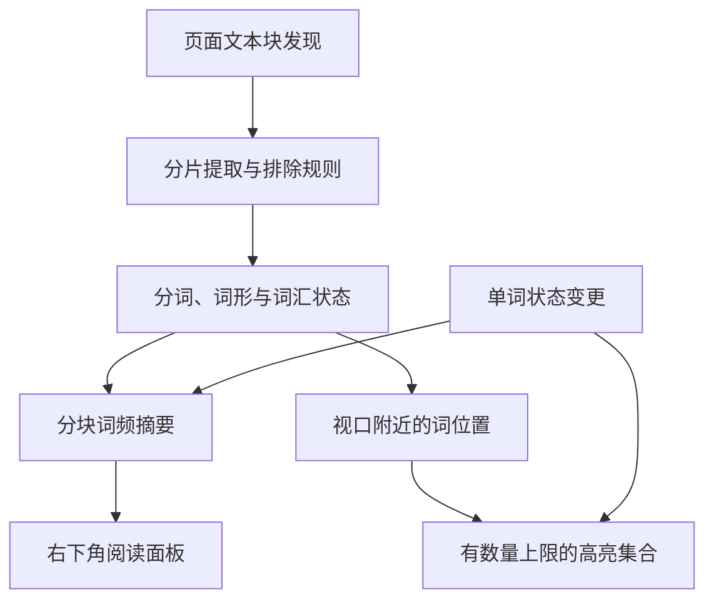

# XGloss 项目规划与调研

调研日期为 2026-11-17。本文保留按用户反馈修订的产品规划，工程已进入 0.1.0 实现阶段。

本次范围调整将 PDF 阅读纳入首版，将欧路接入排到本地功能稳定之后。首版验收覆盖网页和 PDF 的查词、高亮、阅读面板、本地收藏与状态持久化。

## 实施更新

已开始编码，翻译引擎采用可配置的 OpenAI-compatible Chat Completions 协议。网页与 PDF 的本地首版已具备可运行实现，具体完成项和后续适配见 [实现状态](docs/IMPLEMENTATION_STATUS.md)。以下各节保留产品目标与后续验收规划。

## 1. 产品目标与暂定范围

在英文网页和 PDF 阅读中发现值得学的词，保留遇词语境，在本地管理学习状态。首要使用场景是长篇技术文档、数据手册和论文，其次是新闻、博客和 GitHub 文档。手机欧路继续学习列入后续生态接入目标。

依据截图与使用场景，暂定首发支持桌面 Chrome / Edge、英语学习、简体中文界面。本地收藏、词汇状态、分析与基础查词支持离线使用，在线翻译按配置启用。浏览器、语言和界面是规划假设，可在开始实现时调整。

首版体验围绕三个入口展开。

- 页面内 Spotlight，按词汇状态突出需要关注的词。
- 选词卡片，查看释义、发音、原句，标记认识程度或加入生词本。
- 右下角阅读面板，查看词汇覆盖率、待确认词和高频生词，选择本页优先学习的词。

## 2. WordByWord 调研结果

### 2.1 可借鉴的交互

官方 Spotlight 说明包含未知词高亮、学习阶段颜色、掌握与忽略状态，以及页面上直接调整等级的操作。选词卡片支持将阅读中的词汇加入收藏。XGloss 可以沿用“阅读时标记、后续再次遇见”的学习流程，并设计自己的界面。[Spotlight 文档](https://wordbyword.io/en/docs/spotlight-mode)、[扩展使用说明](https://wordbyword.io/en/docs/chrome-extension-setup)

截图右下角对应官方的 Comprehension Level。展开后包含覆盖率环、总词次、去重生词数、学习中词数、高频新词、释义、发音和等级操作。高频词提示用出现次数估算掌握后的覆盖率增量。[阅读面板说明](https://wordbyword.io/en/docs/comprehension-level)

截图中的 59,532、2,442、26 只能视为该次页面展示的数据。XGloss 需要给计数明确标注“词次”和“去重词数”，避免不同单位混在一起。

### 2.2 长页面卡顿的证据边界

用户已在长页面开启 Spotlight 时遇到明显卡顿。v0.2 补充只读检查了电脑上的 Chrome 扩展 1.3.12，内容脚本已包含 CSS Custom Highlight、Range 索引和 TreeWalker 文本遍历，也包含 span 高亮相关路径。PDF 包含 PDF.js 文本层相关实现。CSS Custom Highlight 已被参考产品采用。实际启用路径、活动范围数量、全页扫描频次与耗时仍待性能 trace 验证。

以下是后续要验证的候选原因。

| 候选原因                     | 观察证据                                       |
| ---------------------------- | ---------------------------------------------- |
| 首次同步遍历、分词占用主线程 | 开启时出现长任务，调用栈集中在遍历或字符串处理 |
| 为大量词插入标签             | DOM 节点数显著增长，样式和布局时间增加         |
| 全文 Range 过多              | DOM 增量较小，绘制、Range 维护或堆占用明显增加 |
| 动态变更导致重复全页处理     | 页面局部变化后发生大规模重复扫描               |
| 滚动中频繁测量布局           | 强制布局及布局测量调用密集                     |
| 面板统计与高亮竞争资源       | 单独开启其中一个功能时改善明显                 |

建议在独立测试配置中，对同一 Raspberry Pi 页面分别录制扩展关闭、仅面板、仅 Spotlight、两者同时开启的首次加载与滚动过程。记录浏览器和扩展版本、机器信息、视口、其他扩展、CPU 条件及重复测量结果。依据脚本、布局、绘制和内存数据归因。[Chrome 性能分析文档](https://developer.chrome.com/docs/devtools/performance)

## 3. 首版功能规划

| 功能      | 首版拟交付行为                                       | 验收方式                             |
| --------- | ---------------------------------------------------- | ------------------------------------ |
| 选词查词  | 选词或双击打开卡片，支持短语手动收藏                 | 正常选择、复制、链接点击可用         |
| 学习状态  | 待确认、学习中 1–4、已掌握、忽略                     | 状态改变后本页和其他标签页更新       |
| Spotlight | 按状态高亮视口附近的有效文本                         | 长页滚动稳定，关闭后释放资源         |
| 阅读面板  | 覆盖率、分析范围、词次、高频词和学习操作             | 各项统计使用一致语料与词形规则       |
| 本地词库  | 词条、原句、来源、状态和释义缓存                     | 离线标记、重启恢复、导出再导入       |
| PDF 阅读  | 本地与在线 PDF，选词、高亮、阅读面板、页码与来源记录 | 长文档翻页、缩放和重新打开后定位可用 |
| 站点控制  | 当前页开关、按站点记忆、代码区域设置                 | API 文档、博客、SPA 分别验证         |

YouTube 字幕、更多语言、独立复习算法、自建账号云同步和欧路接入列入后续候选。首版开发顺序优先完成网页与 PDF 到本地词库的阅读学习流程。

## 4. Spotlight 性能设计

### 4.1 文本分析与显示分别调度

页面处理分成可见文本高亮和渐进词频统计两个任务。高亮具有更高调度优先级。统计逐批扩大分析范围，在界面中持续显示当前范围。



### 4.2 高亮机制

优先验证 CSS Custom Highlight API。它允许通过文本范围设置高亮，并保持原页面文本结构。原型需要验证扩展隔离世界中的注册与样式作用域、目标 Chrome / Edge 版本、网页现有高亮、深色主题和点击定位。[Chrome 高亮指南](https://developer.chrome.com/docs/modern-web-guidance/guides/ui-behaviors/highlight-text-ranges)

该 API 仍然有范围维护与绘制成本。CSSWG 规范特别讨论了大量动态 Range 的维护开销，因此需要控制活动范围数量，并测试 Range 和 StaticRange 的适用条件。[CSS Custom Highlight 规范](https://www.w3.org/TR/css-highlight-api-1/)

实现建议如下。

1. 按段落、列表项和表格单元格发现文本块，分片建立索引。超大单块继续按字符窗口切分。
2. 使用 IntersectionObserver 观察块级容器，预取视口上下约一屏。观察目标也设数量上限，长文逐步发现。
3. 只为当前窗口建立高亮范围。离开缓存区时释放范围和文本节点引用，保留紧凑词频摘要。
4. 每种状态使用一个命名 Highlight 集合，集中提交更新。设置活动范围硬上限，原型起始候选值为 5,000，依据实际密度与测量调整。
5. 点击时根据坐标定位文本节点和偏移，再匹配本块词位置。采用事件委托处理交互。链接上的查询通过选词或修饰键触发，保留正常导航动作。
6. 处理跨行、跨行内标签的单词与选择内容，区分显示词形和词条键。

IntersectionObserver 回调仍在主线程执行，回调内只入队，分词和范围构造交给有预算的任务。坐标取词可验证 caretPositionFromPoint，并为目标浏览器提供 caretRangeFromPoint 兼容路径。[IntersectionObserver 文档](https://developer.mozilla.org/en-US/docs/Web/API/Intersection_Observer_API)、[坐标取词文档](https://developer.mozilla.org/en-US/docs/Web/API/Document/caretPositionFromPoint)

### 4.3 增量分析与资源预算

- 首屏优先，单批脚本工作预算初拟 4–8 ms。每批同时限制字符数和节点数，以实际耗时结束本批。
- 使用有超时兜底的空闲任务或定时分片，让浏览器在任务之间处理交互。微任务连续执行需要避免形成长时间占用。
- DOM 提取保留在内容脚本。纯分词与统计在原型阶段比较分片运行和 Worker 方案，并计入传输、打包和 CSP 成本。
- MutationObserver 只收集变更块。去重合并后，先扣除块的旧词频，再加入新词频，忽略扩展自己的 UI。
- 页面切换使用 generation 标记，取消旧任务，丢弃过期异步结果。移除块及时释放索引和范围。
- 页面隐藏后暂停低优先级统计，恢复可见时续跑。关闭功能时注销观察器、事件及调度任务。
- 块缓存和总字符处理量设上限。达到上限时展示“分析范围受限”，允许用户继续分析。
- 高频动态页面对变更积压实施合并与限速，优先保证当前阅读窗口。

仅做视口高亮时，活动范围成本应受视口和预算约束。完整词频统计仍随有效文本量增长，分片发现及摘要也需要计入性能测量。

### 4.4 页面适配规则

首版默认优先 main / article 等正文区域，同时识别技术文档正文表格，排除导航、页脚、搜索框、script、style、可编辑区域和代码块。行内 code 默认排除，提供技术词学习设置。

对 hardware_adc、GPIO15、标识符、路径、URL、邮箱和纯数字制定单独过滤规则。首字母大写词需结合句首与词典信息判断。界面允许用户恢复被过滤的有效术语。

普通 HTML、嵌套滚动容器、SPA 和无限滚动分别验证。开放 Shadow DOM 与授权 iframe 按根维护索引。浏览器内部页、商店页、内置 PDF、关闭的 Shadow DOM 等情况需要显示适用范围，按后续适配能力扩展。

### 4.5 PDF 的实现路径

使用扩展自带的 PDF.js 阅读页，入口包括“打开本地 PDF”和“用 XGloss 打开当前在线 PDF”。本地文件通过文件选择或拖放读取 ArrayBuffer，在线文件在获得来源权限后读取。带登录态、临时链接和下载限制的在线 PDF 单独验证，提供下载后本地打开入口。[PDF.js 入门](https://mozilla.github.io/pdf.js/getting_started/)

阅读器按以下层次组成。

- PDF.js Worker 解析文档，Canvas 绘制原页，TextLayer 提供可选择文字及位置映射，AnnotationLayer 承接文档链接。
- 页面级适配器将文本内容转换为共享的分词、词形、词频和状态数据，网页与 PDF 使用同一套学习逻辑。
- 首先验证在 PDF.js TextLayer 上绘制 CSS Highlight 的对齐与可见性。透明文字层下的高亮效果按缩放、旋转测试，必要时按范围矩形在页内绘制背景覆盖层。
- 仅渲染可见页及相邻缓存页，远离视口后取消渲染并回收 Canvas、TextLayer、高亮与节点映射。页数占位和词频摘要独立保留。
- 文本提取按页排队，当前页优先，后台逐页补充词频。界面显示“已分析 12 / 300 页”，支持当前页和累计已分析范围。
- 保存文档标识、页码、原句、页内文本位置及词形。定位同时校验原句，缩放或旋转后按新视口重建位置。
- 阅读位置保存在本地。重新选择本地文件后按文档标识恢复进度，文档标识结合 fingerprint 和文件属性核对。文件原件的本地缓存作为单独设置。

阅读页、Worker、字体和 CMap 等所需资源随扩展打包。页面渲染生命周期必须自行控制，PDF.js 的使用方案需要按活动页数与像素预算管理内存。[PDF.js 内存与可见页说明](https://github.com/mozilla/pdf.js/wiki/Frequently-Asked-Questions)

首版 PDF 验收包含本地和在线文本 PDF、300 页以上技术手册、双栏论文、连字符断行、连字、跨 TextItem 单词、缩放、旋转、跳页与密码输入。抽取后的词和原句需要复核阅读顺序。扫描 PDF 显示文本层缺失状态，OCR 安排为独立扩展阶段，加入后沿用同一套学习功能。

## 5. 右下角阅读面板

### 5.1 展示结构

折叠时显示覆盖率和分析状态。展开后的顺序如下。

1. 词汇覆盖率环和正文 / 全页范围选择。
2. 已分析有效词次、待确认去重词数、学习中去重词数。
3. 本页优先学习的 5–15 个高频词，支持刷新与定位原句。
4. 每个词显示简短中文释义、出现次数、发音、状态按钮和本地收藏状态。
5. 显示掌握所选词后预计增加的覆盖率。

支持收起、关闭、键盘操作和停靠位置调整，窄窗口自动缩小。面板本体使用 Shadow DOM 隔离样式，高亮样式单独处理。

### 5.2 统计口径

设当前范围有效词次为 T，已掌握词出现次数为 K。

```text
词汇覆盖率 = K / T × 100%
掌握候选词集合 S 后的覆盖率增量 = S 中尚未掌握词的出现次数之和 / T × 100%
```

过滤与忽略项同时退出分子、分母和候选列表。词形归并使用同一套规则，候选词以去重词条计数，贡献按出现词次计算。学习中单独统计，首版拟在明确标为“已掌握”后计入 K。

例如有效词次为 10,000，已掌握词出现 8,000 次，覆盖率为 80%。候选的 15 个词累计出现 200 次，则预测增加 2 个百分点。

分析过程中显示“已分析内容的覆盖率”。只有完成所选 DOM 范围后才显示“本页统计完成”。无限滚动和虚拟列表显示“当前已加载内容”或“本次阅读累计”，使用用户可理解的范围名称。有效样本过少时显示样本不足。

### 5.3 初始词汇水平

空词库中的词先标记为“待确认”。初次使用可导入本地熟词表，或通过词表分批确认。欧路已掌握词导入安排在后续接入阶段。未校准时提示覆盖率基于已记录词汇，避免把数据缺失直接解释成能力低。

词形处理以可靠词形表为基础，保留原词和归并结果。对不规则变形、缩写和多义词保留人工修正。短语收藏独立建条目，首版覆盖率采用单词口径，后续再定义短语覆盖重叠规则。

## 6. 欧路生态可行性

本节保留已完成的接口调研，实施顺序已后移。以下同步阶段用于后续接入，本地首版验收按第 9 节执行。

### 6.1 已核实的官方公开能力

欧路开发指南网页通过脚本加载 Markdown。本轮读取了官方页面以及对应 Markdown，以下内容依据调研当日文档，实际账号联调仍待实施。[官方入口](https://my.eudic.net/OpenAPI/Doc_Index)、[指南正文](https://my.eudic.net/doc/index.md)

| 需求             | 官方文档能力                                            | XGloss 拟采用方式                        |
| ---------------- | ------------------------------------------------------- | ---------------------------------------- |
| 选择目标生词本   | 读取与管理 category                                     | 用户选择现有词本，可创建 XGloss 专用词本 |
| 添加词和阅读原句 | POST studylist/word 含 context_line、star、category_ids | 收藏时提交单词及原句                     |
| 批量收藏         | POST studylist/words 支持 items 与星级                  | 导入与积压批次采用小批处理               |
| 拉取生词         | GET studylist/words 提供词、释义、星级、语境            | 导入、状态缓存与核对                     |
| 手机端掌握后回传 | GET studylist/mastered_words                            | 定期读取已掌握标记，联调验证 App 行为    |
| 保存额外内容     | 单词笔记读写接口                                        | 来源链接等可放入受管理笔记段             |
| 打开客户端查词   | eudic://dict/word 支持 context                          | 词卡提供“欧路查词”入口                   |

接口细节见官方规范。[生词本 API](https://my.eudic.net/doc/api_study.md)、[笔记 API](https://my.eudic.net/doc/api_note.md)、[URL Scheme](https://docs.eudic.net/1/jin-jie-gong-neng/url-scheme)

官方已掌握列表与收藏星级分别存在。XGloss 的学习阶段需要保留自己的语义，再通过联调确定与欧路星级的映射。已读文档提供已掌握词查询与移除接口，新增已掌握标记的写入方式仍需进一步核实。

查阅的公开接口以个人生词和语料为中心。对任意陌生词即时查询释义的能力需要单独落实，欧路生词本 API 的 exp 字段可用于已拉取词条的释义缓存。

### 6.2 建议分阶段打通

第一阶段完成桌面收藏到手机复习。

- 用户填写个人 Authorization，并选择目标词本。
- 收藏先写本地事务，同时生成持久化同步任务。
- 成功提交到欧路后展示“已同步”。离线时展示“待同步”，恢复联网后重试。
- 在手机欧路刷新词本，确认词、原句和目标分组。

第二阶段补充手机到桌面的反馈。

- 拉取欧路生词和已掌握词，与本地快照比较。
- 优先验证手机“已掌握”动作在公开接口中的可见性和延迟。
- 本地尚未上传的人工修改保留待处理标志，远端数据先作为独立版本保存。
- 删除、移出词本、星级变化和掌握状态分别处理。同一词在多词本中的归属需要保留。
- 高级冲突允许用户选择本地或远端，完成联调后再决定自动规则。

### 6.3 同步约束与实现原则

调研当日官方指南写明每分钟 30 次、30 分钟 500 次，超限分别可能封停 1 小时和 24 小时。后续接入采用低于上限的全局限速队列，候选初值为每分钟 10 次，并限制 30 分钟累计预算。所有标签页共享队列。[官方流量说明](https://my.eudic.net/doc/index.md)

- 首次连接按需拉取，之后在浏览器活跃时低频刷新，提供手动同步。
- 文档中的部分列表页码上限为 50、每页最大 100。触及分页边界时展示同步范围受限，进一步核实完整导出方式。
- add_time 按添加时间处理。同步完整性依赖快照和核对，需要另外验证更新、删除及分页期间变更的行为。
- 批量写入可能部分成功。请求超时或 500 时先核对目标状态，再重试尚未满足目标的词，保留任务标识、尝试次数和错误。
- 401 暂停队列并提示更新授权。403 按流量封停处理，429 遵循服务端等待信息，网络及 5xx 使用有上限的退避。
- 写入任务按账号、语言、词条和目标操作去重，同词串行，防止旧任务覆盖新状态。
- 批量笔记接口会覆盖已有文字笔记。笔记增强单独做合并设计，保留远端原文和冲突副本，再写入 XGloss 管理段。
- star=0 在当前文档中具有删除收藏的含义。适配器必须显式区分移除收藏与学习状态操作。

具体账号联调应覆盖重复添加、已有语境、不同分组、大小写、词形、部分写入、手机同步延迟和撤销掌握。以上接口能力目前完成文档核实，运行行为待验收。

## 7. 查词和本土化扩展

### 7.1 WordByWord 使用的服务

官方隐私政策明确披露，翻译文本由 Yandex Cloud Translate 处理，发音文本由 Google Cloud Text-to-Speech 处理。此结论来自服务商声明，查询日期为 2026-11-17。当前已安装扩展版本为 1.3.12，实际翻译请求链路尚未抓包核实。[官方隐私政策](https://wordbyword.io/en/privacy-policy)

### 7.2 XGloss 查词与翻译方案

首版提供本地基础英汉词典，用于网页与 PDF 卡片的即时释义。ECDICT 提供英汉释义、词频与词形资源，可作为候选，需要在 P0 检查数据质量、资源体积、打包方式和所用数据的许可要求。[ECDICT 项目](https://github.com/skywind3000/ECDICT)

高亮状态和词频统计只依赖本地词汇状态。释义按用户操作或面板候选词查询、缓存，避免全文逐词联网。词典资源采用分片索引，原型需要量化首次安装与查词耗时。

词卡先展示本地词典义项，短语和句子按需调用在线翻译。翻译服务通过统一接口返回文本、语言、提供商与模型信息，并缓存结果。缓存键包含服务、模型、原文、语种及语境，避免同一个词在不同句子中误用缓存。

本土化在线翻译候选为阿里云 Qwen-MT，官方支持术语干预、翻译记忆和领域提示。技术文档可配置电子、嵌入式等领域提示，使用一组真实文档样本评估歧义词、短语和长句。模型选型与服务开通在需要联网翻译时确定。[Qwen-MT 官方文档](https://help.aliyun.com/en/model-studio/machine-translation)

需要“当前句子中的这个词是什么意思”时，保留原句与目标词位置，通过支持该任务的上下文释义服务返回结果，并与基础词典义项分别展示。Qwen-MT 的具体上下文能力和参数以接入时文档为准，模型翻译与目标词释义分别验收。

在线查询由用户操作触发，提供取消、超时、错误展示和缓存，按词卡和面板需求限量请求。首版核心学习功能使用本地数据，在线服务可以按配置启用。质量评估包含同词异义、专业术语、短语、标点、原句保真和响应耗时。

发音先评估系统 speechSynthesis 的英文语音可用性，在目标电脑实测。后续可增加在线语音服务，通过独立配置启用。

后续生态接入时按能力声明实现生词本适配器，优先考虑欧路。用户数据始终提供 JSON 备份和 CSV 词表导出。

## 8. 技术结构建议

| 层级     | 暂定技术与职责                                                        |
| -------- | --------------------------------------------------------------------- |
| 扩展工程 | Manifest V3、TypeScript、WXT                                          |
| 页面核心 | 原生 DOM API，文本发现、分片、索引、高亮和增量处理                    |
| UI       | Vue 3，用于词卡、阅读面板、设置页和本地词库页                         |
| PDF      | PDF.js、自带 Worker、Canvas / TextLayer / AnnotationLayer、页级虚拟化 |
| 持久化   | 扩展源 IndexedDB 存词条、遇词记录、文档阅读位置、释义缓存及词典索引   |
| 设置     | chrome.storage 存站点偏好、界面设置和受限访问的凭据配置               |
| 后台     | Service Worker 管理消息、事务写入、跨标签页通知及可选翻译请求         |

WXT 是扩展开发框架，提供构建和入口组织能力。最终依赖版本在初始化时确定并锁定。[WXT 官方文档](https://wxt.dev/guide/introduction.html)

内容脚本维护有限的词汇状态快照，发送状态变更消息。后台在 IndexedDB 事务中写词条和遇词记录，再通知相关标签页。生态同步阶段再加入持久化 outbox。遇词记录可包含原词、词条键、上下文、来源 URL、标题、时间及语言。记录数量与原句长度可配置。

Service Worker 可能随时终止。已确认保存的数据需要持久化，启动和事件唤醒时重新加载。事务完成后再向界面确认本地保存。[后台生命周期](https://developer.chrome.com/docs/extensions/develop/concepts/service-workers/lifecycle)

Chrome storage.sync 有约 100 KB 的配额，适合少量设置。主要词库和学习语境存入 IndexedDB，另设可导出的备份格式。[扩展存储文档](https://developer.chrome.com/docs/extensions/reference/api/storage)

页面处理在本地进行。首次版本拟由用户点击扩展启用当前页，可按站点授权并记忆自动启用设置。基础权限按实现申请 storage、scripting、activeTab。在线 PDF 与翻译服务按需申请其来源访问权限。欧路相关权限在后续接入阶段申请。

API 请求从扩展后台发送。消息只接受预定义操作和受校验参数，凭据存储限制为 TRUSTED_CONTEXTS，日志脱敏。用户发起在线翻译时按配置提交选中文字及所需上下文，界面标注服务来源。[跨域请求文档](https://developer.chrome.com/docs/extensions/develop/concepts/network-requests)、[存储访问控制](https://developer.chrome.com/docs/extensions/reference/api/storage)

## 9. 实施阶段与验收

| 阶段            | 交付内容                                                    | 进入下一阶段的条件                             |
| --------------- | ----------------------------------------------------------- | ---------------------------------------------- |
| P0 可行性验证   | 长页高亮原型、PDF TextLayer 取词与页级回收、词典资源试验    | 长页与长 PDF 性能有数据，缩放后取词对齐        |
| P1 阅读基础     | 本地词库、选词卡片、学习状态、Spotlight、站点开关           | 日常网页与长技术文档可稳定阅读                 |
| P2 阅读面板     | 范围与进度、覆盖率、高频词、原句定位和增量更新              | 固定样本文本统计可复核，动态文本增删后计数一致 |
| P3 PDF 完整流程 | 本地与在线打开、选词、高亮、覆盖率、阅读进度和遇词定位      | 网页与 PDF 共享词汇状态，长文档资源按页回收    |
| P4 本地首版验收 | 词库管理、JSON / CSV 导入导出、离线恢复、兼容性修复、安装包 | 用户可在网页和 PDF 中持续使用，重启后数据完整  |
| 后续生态接入    | 欧路账号与词本、同步队列、已掌握词拉取                      | 完成本地首版后再开展手机端联调                 |

P0 结果用于确定高亮窗口预算和 PDF 页级缓存大小。最终工期在 P0 结束后估算，主要不确定性来自复杂网页、PDF 文本提取与词典资源。按需在线翻译可在本地首版基础上接入并独立验收。

### 9.1 性能验收草案

下列是工程目标，尚无实现测量结果。P0 先记录测试机器、浏览器、视口、CPU 条件及数据集，再校准阈值。

| 场景或指标 | 初拟目标                                                             |
| ---------- | -------------------------------------------------------------------- |
| 长度梯度   | 1 万、10 万、100 万有效英文词次，另测大量 DOM 和超大单文本块         |
| 首屏高亮   | 本地词汇缓存就绪后 P95 小于 300 ms，冷启动另报                       |
| 主线程批次 | 分片预算 4–8 ms，追踪扩展归因的超过 50 ms 长任务                     |
| 滚动       | 60 Hz 测试下 P95 帧间隔相对关闭扩展的增量目标不超过 4 ms             |
| 状态交互   | 本地标记反馈 P95 小于 100 ms                                         |
| PDF 渲染   | 记录 300 页以上文件的活动页数、Canvas 像素预算与往返跳页后的内存趋势 |
| 活动范围   | 遵守预设硬上限，重复往返滚动后范围数量稳定                           |
| 内存       | 分别报告高亮与完整统计增量，清理断开节点引用，重复开关后无持续增长   |
| 关闭       | 清空高亮、取消后台分析和观察器，后续任务不再写入当前页面             |

兼容性样本包含截图中的 Raspberry Pi Hardware APIs、普通文章、GitHub Markdown、嵌套滚动表格、SPA、无限滚动、虚拟列表、中英混排、行内代码、可编辑区域和深色主题。另测同时运行翻译扩展时的交互。

### 9.2 首次端到端验收

1. 在长技术文档启用 XGloss，阅读、滚动和复制文本。
2. 从右下角面板选择一个高频待确认词，查看释义及原句。
3. 收藏该词，看到本地保存状态，标记掌握后检查其他标签页更新。
4. 打开本地 PDF，选词、收藏，缩放、旋转和跳页后检查高亮及原句定位。
5. 打开在线 PDF，检查授权、加载、错误反馈和阅读进度恢复。
6. 模拟断网和浏览器重启，确认词汇、遇词记录及阅读位置可恢复。
7. 导出 JSON 备份后重新导入，核对学习状态和来源。CSV 导入按词表能力单独验收。

## 10. 开始实现前的选择

规划暂按 Chrome / Edge、网页与文本 PDF、英汉阅读和本地词库推进。后续讨论优先确定以下体验选择。

- 学习等级采用简单的“学习中 / 已掌握”，还是保留 1–4 的细分。
- Spotlight 默认突出全部待确认词，还是优先突出用户已收藏的词。
- 在线翻译按需启用时，采用的服务和模型。

P0 优先验证长网页流畅阅读、长 PDF 按页处理和共享本地词汇状态。验证完成后细化实现任务与依赖。
