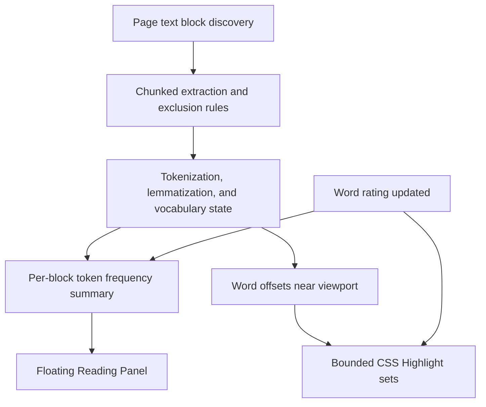

# XGloss Project Plan & Research Notes

Research date: `2026-11-17`. This document preserves the initial product research and architecture plan revised from user feedback as the repository moved into `0.1.0+` implementation.

The v1 scope prioritizes local web and PDF reading (deferring third-party Eudic sync until core local workflows stabilize). First-release acceptance covers web and PDF lookup, viewport highlighting, the floating Reading Panel, local vocabulary management, and persistent state.

## Implementation Update

Implementation is underway using a configurable OpenAI-compatible Chat Completions translation adapter. Working local builds for both web reading and the PDF reader are tracked in [Implementation Status](docs/IMPLEMENTATION_STATUS.md). Sections below preserve the product goals and engineering design criteria.

## 1. Product Goals & Initial Scope

Discover worthwhile words while reading English technical web pages and PDFs, retain encounter contexts, and manage mastery status locally. Primary reading targets are long technical manuals, datasheets, and academic papers, followed by news articles, blogs, and GitHub documentation. Mobile companion sync (e.g., Eudic) is slated for post-local ecosystem integration.

Initial targets focus on desktop Chrome / Edge, local-first storage, offline lookup/coverage analysis, and configurable online translation. Browser targets, supported languages, and UI capabilities may expand iteratively.

Core experience revolves around three entrypoints:

- **In-page Spotlight**: Highlights unknown and learning words subtly according to local vocabulary state.
- **Selection Word Card**: Shows context-aware meanings or full translations, pronunciation, source context, and familiarity rating controls.
- **Floating Reading Panel**: Displays reading coverage, unknown/learning counts, high-frequency unknown candidates, and estimated coverage gain.

## 2. Competitive Research (WordByWord)

### 2.1 Reference Interactions

WordByWord Spotlight highlights unknown words, learning grades, known/ignored states, and inline rating adjustments from the page ([Spotlight Docs](https://wordbyword.io/en/docs/spotlight-mode), [Chrome Extension Setup](https://wordbyword.io/en/docs/chrome-extension-setup)). The bottom-right Comprehension Level widget shows coverage ring, token counts, distinct unknown words, frequent words with estimated gain, glosses, audio, and familiarity buttons ([Comprehension Level](https://wordbyword.io/en/docs/comprehension-level)).

XGloss distinguishes explicitly between total token occurrences and unique word counts so metrics remain unambiguous.

### 2.2 Long-Page Performance Investigation Boundaries

Users reported noticeable jank when enabling Spotlight on very long web pages (such as Raspberry Pi Hardware APIs documentation). Inspection of reference extensions shows mixed paths combining CSS Custom Highlight API, `Range` indexes, `TreeWalker` scans, and span wrappers, alongside PDF.js text layers. Candidate bottlenecks to benchmark and prevent:

| Candidate Cause                                        | Observed Symptom                                    |
| ------------------------------------------------------ | --------------------------------------------------- |
| Synchronous initial DOM walk & tokenization            | Long main-thread tasks clustered in text traversal  |
| Wrapping large numbers of words in DOM spans           | High DOM node growth triggering style/layout churn  |
| Excessive active `Range` objects                       | Memory growth and paint/range maintenance overhead  |
| Repeated full-page rescans on DOM mutations            | Re-indexing spikes on partial page updates          |
| Forced synchronous layout measurements while scrolling | Layout thrashing in scroll handlers                 |
| Contention between panel statistics and highlighting   | Turning one feature off measurably relieves stutter |

Recommended profiling methodology isolates disabled, panel-only, Spotlight-only, and combined runs on identical long reference pages while capturing main-thread scripting, layout, paint, and heap metrics ([Chrome Performance Docs](https://developer.chrome.com/docs/devtools/performance)).

## 3. Core Feature Matrix

| Capability       | Planned Behavior                                                   | Verification Criteria                                           |
| ---------------- | ------------------------------------------------------------------ | --------------------------------------------------------------- |
| Selection Lookup | Double-click or drag selection opens card; phrase saving supported | Normal copy, text selection, and link navigation remain intact  |
| Learning States  | Unknown, Learning `1-4`, Known, Ignored                            | Updates propagate to open web tabs and PDF pages immediately    |
| Spotlight        | Highlights valid tokens near the viewport per mastery state        | Smooth scrolling on long pages; full cleanup on disable         |
| Reading Panel    | Coverage %, analyzed scope, token counts, frequent candidates      | Statistics follow shared tokenization and exclusion rules       |
| Local Library    | Terms, encounter sentences, sources, ratings, cached meanings      | Offline rating, browser restart persistence, JSON/CSV roundtrip |
| PDF Reader       | Local & online PDFs, lookup, highlights, coverage, page progress   | Long-document paging, zoom, rotation, and progress recovery     |
| Site Controls    | Per-site toggle, code-block exclusions                             | Verified across API docs, blogs, SPAs, and non-HTTPS hosts      |

YouTube captions, additional language pairs, standalone SRS scheduling extensions, self-hosted sync, and Eudic integration follow core local reading milestones.

## 4. Spotlight Performance Design

### 4.1 Separated Highlighting & Statistical Scheduling

Page processing separates viewport highlighting from progressive token counting. Highlighting takes scheduling priority, while statistical summarization expands incrementally within time/node budgets.

### 4.2 Highlight Mechanism

CSS Custom Highlight API avoids mutating page DOM structure while keeping style encapsulation cleanly isolated ([Chrome Highlight Guide](https://developer.chrome.com/docs/modern-web-guidance/guides/ui-behaviors/highlight-text-ranges), [CSS Highlight Spec](https://www.w3.org/TR/css-highlight-api-1/)).

Design guidelines:

1. Discover block containers (paragraphs, list items, table cells) and split oversized blocks into bounded character windows.
2. Observe blocks with `IntersectionObserver` across a ~1-screen buffer above/below the viewport, capping pending observation targets on massive pages.
3. Build `Range` instances only for the active viewport window and release detached ranges/node references upon exit while retaining lightweight frequency summaries.
4. Maintain named highlight sets per state and enforce a hard active-range ceiling (`5,000` starting budget).
5. Support coordinate-based lookup fallback (`caretPositionFromPoint` / `caretRangeFromPoint`) without breaking link clicks ([IntersectionObserver API](https://developer.mozilla.org/en-US/docs/Web/API/Intersection_Observer_API), [caretPositionFromPoint](https://developer.mozilla.org/en-US/docs/Web/API/Document/caretPositionFromPoint)).
6. Handle selections spanning inline tags while distinguishing display text from normalized dictionary keys.

### 4.3 Incremental Analysis & Resource Budgets

- Prioritize above-the-fold content with target `4-8 ms` script slice budgets bounded by both character and node counts.
- Yield cleanly to browser input/render cycles between chunks.
- Coalesce `MutationObserver` updates: subtract prior block counts before adding updated block tokens, ignoring `#xgloss-root` UI mutations.
- Guard async work with generation counters to discard stale page/navigation work immediately.
- Pause low-priority background scanning while tabs are hidden; clean up all listeners, observers, and highlights on teardown.
- Enforce total character analysis caps and surface partial-analysis status cleanly when reached.

### 4.4 DOM Filtering Rules

Prioritize primary content landmarks (`main`, `article`, `[role="main"]`) alongside technical documentation tables while excluding `nav`, `footer`, search bars, `script`, `style`, `[contenteditable]`, and code blocks (`pre` / inline `code` identifiers like `hardware_adc` and `GPIO15`, URLs, emails, and standalone numbers). Support testing across standard articles, nested scroll containers, SPAs, infinite scrolling, and non-HTTPS hosts.

### 4.5 PDF Implementation Path

Bundle an extension-hosted PDF.js viewer supporting local file pickers/drag-and-drop (`ArrayBuffer`) and origin-authorized remote PDFs ([PDF.js Getting Started](https://mozilla.github.io/pdf.js/getting_started/), [PDF.js FAQ](https://github.com/mozilla/pdf.js/wiki/Frequently-Asked-Questions)):

- Separate PDF.js Worker parsing, Canvas rendering, transparent selectable TextLayer, and AnnotationLayer links.
- Share domain tokenization, normalization, coverage calculation, and vocabulary state seamlessly between web and PDF adapters.
- Render only visible and adjacent buffer pages, cancelling offscreen tasks and reclaiming canvases under a strict pixel budget.
- Queue background page text extraction prioritizing the current viewport page while showing progressive page counts.
- Persist document progress and bookmarks by document fingerprint + file attributes.

## 5. Floating Reading Panel

### 5.1 Panel Layout

Collapsed state shows reading coverage percentage (expanding to difficulty and unknown counts on hover/focus). Expanded panel provides:

1. Coverage metric ring and analyzed scope counts (total valid tokens, unique unknown words, learning count).
2. High-frequency unknown candidates (`5-15` batch) with inline meanings, occurrence counts, audio playback, rating buttons, and manual refresh.
3. Estimated coverage points gained by mastering remaining candidates in the page.
4. Recall Mode toggle to conceal glosses until explicitly revealed, keyboard accessibility, and Shadow DOM style isolation.

### 5.2 Coverage Formulas

Let $T$ be total valid non-ignored token occurrences in the analyzed scope, and $K$ be occurrences of `known` words:

$$\text{Coverage} = \frac{K}{T} \times 100\%$$

$$\text{Estimated Gain for Candidate Set } S = \frac{\sum_{w \in S \setminus \text{Known}} \text{count}(w)}{T} \times 100\%$$

Ignored words are excluded from both numerator and denominator. For example, if $T = 10{,}000$ and $K = 8{,}000$, baseline coverage is `80%`; mastering candidates summing to `200` occurrences yields `+2` percentage points.

### 5.3 Cold-Start Calibration

Unrecorded words start as `unknown`. Users can import existing wordlists via CSV/JSON or adjust ratings directly in reading panels and the Library table so coverage stabilizes quickly around their real level.

## 6. Future Eudic Integration Feasibility

Retained API research for post-local ecosystem integration ([Eudic OpenAPI Index](https://my.eudic.net/OpenAPI/Doc_Index), [OpenAPI Guide](https://my.eudic.net/doc/index.md), [Studylist API](https://my.eudic.net/doc/api_study.md), [Note API](https://my.eudic.net/doc/api_note.md), [URL Scheme](https://docs.eudic.net/1/jin-jie-gong-neng/url-scheme)):

| Requirement                     | Official Endpoint Capability                                   | Proposed Adapter Design                 |
| ------------------------------- | -------------------------------------------------------------- | --------------------------------------- |
| Target notebook selection       | Read/create studylist `category`                               | Map to dedicated or existing notebook   |
| Add words & contexts            | `POST studylist/word` (`context_line`, `star`, `category_ids`) | Persist local transaction + sync outbox |
| Batch additions                 | `POST studylist/words` with star levels                        | Chunked batch worker                    |
| Pull studylist & mastered words | `GET studylist/words`, `GET studylist/mastered_words`          | Snapshot diff + conflict retention      |
| Source notes                    | Note read/write APIs                                           | Managed XGloss note sections            |
| Desktop client lookup           | `eudic://dict/word` URL scheme                                 | Optional card shortcut                  |

Future implementation must respect documented rate limits (`30 req/min`, `500 req/30min`) with a shared global rate-limited queue, `401`/`403`/`429`/`5xx` backoff handling, and careful handling of `star=0` deletion semantics.

## 7. Dictionary & Localization Architecture

- **Privacy Reference**: WordByWord privacy policy notes Yandex Cloud Translate and Google Cloud TTS ([WordByWord Privacy Policy](https://wordbyword.io/en/privacy-policy)). XGloss adopts local-first storage and user-configured BYO endpoints (`OpenAI-compatible` Chat Completions, e.g. DeepSeek or local servers, plus [Qwen-MT](https://help.aliyun.com/en/model-studio/machine-translation) compatibility notes).
- **Hybrid Dictionary Strategy**: Bundle an offline 44,688-entry ECDICT dataset sharded by prefix ([ECDICT](https://github.com/skywind3000/ECDICT)) for zero-latency fallback, paired with on-demand contextual translation cached in IndexedDB by provider config, language direction, text, and sentence context.
- **Audio**: Initial pronunciation uses Web `speechSynthesis`, expandable to optional online TTS endpoints later.

## 8. Technical Architecture Summary

| Layer                 | Technology & Responsibility                                                                                                                                                                                                                                 |
| --------------------- | ----------------------------------------------------------------------------------------------------------------------------------------------------------------------------------------------------------------------------------------------------------- |
| Extension Shell       | Chrome / Edge Manifest V3, TypeScript, [WXT](https://wxt.dev/guide/introduction.html)                                                                                                                                                                       |
| Web Content Core      | Native DOM APIs, chunked TreeWalker scanning, CSS Custom Highlight API                                                                                                                                                                                      |
| UI Framework          | Vue 3 (`WordCard`, `ReadingPanel`, `ShadcnSelect`, Popup, Workspace pages)                                                                                                                                                                                  |
| PDF Engine            | PDF.js with dedicated worker, Canvas / TextLayer / AnnotationLayer, page lifecycle                                                                                                                                                                          |
| Local Persistence     | Extension-origin IndexedDB (`words`, `encounters`, `activities`, `collections`, `translations`, `progress`, `bookmarks`)                                                                                                                                    |
| Preferences & Secrets | `chrome.storage.local` (`TRUSTED_CONTEXTS`) + runtime host permissions ([Storage Docs](https://developer.chrome.com/docs/extensions/reference/api/storage), [Network Docs](https://developer.chrome.com/docs/extensions/develop/concepts/network-requests)) |
| Service Worker        | Background message router, transactional persistence, cross-tab notifications, concurrent translation scheduler                                                                                                                                             |

Remember Chrome Service Worker lifecycle constraints: persist state in IndexedDB/storage before acknowledging UI writes and reload on worker wakeup ([Service Worker Lifecycle](https://developer.chrome.com/docs/extensions/develop/concepts/service-workers/lifecycle)).

## 9. Implementation Phases & Acceptance Targets

| Phase              | Deliverables                                                               | Exit Gate                                                    |
| ------------------ | -------------------------------------------------------------------------- | ------------------------------------------------------------ |
| P0 Feasibility     | Long-page highlight prototype, PDF TextLayer + GC checks, ECDICT sharding  | Measured throughput & aligned selection across zoom/rotation |
| P1 Reading Core    | Local library, `WordCard`, learning states, Spotlight, per-site toggle     | Stable web reading on blogs and technical docs               |
| P2 Reading Panel   | Scope progress, coverage %, candidate batch, Recall Mode, incremental diff | Consistent token metrics before/after DOM mutations          |
| P3 PDF Flow        | Local & online PDFs, layout toggles, outline, bookmarks, shared word state | Cross-surface word state sync & bounded page canvas usage    |
| P4 Local v1 Polish | Collections, JSON v2 / CSV backup, offline recovery, store bundle          | Complete end-to-end daily reading loop & reload persistence  |
| Post-v1 Ecosystem  | Eudic sync adapter, additional languages, OCR for scanned PDFs             | End-to-end sync verification after local v1 stability        |

### 9.1 Engineering Performance Targets (Reference Goals)

To be benchmarked on real long documents (10k / 100k / 1M valid tokens, complex manuals, SPAs, nested scrollers):

- Initial viewport highlight P95 `< 300 ms` once local vocabulary cache is loaded.
- Chunked main-thread slices budgeted around `4-8 ms`; avoid `> 50 ms` long tasks during scroll.
- Local rating UI acknowledgement P95 `< 100 ms`.
- Strict range ceiling adherence (`<= 5,000` ranges) and clean reference release on teardown.

### 9.2 End-to-End Acceptance Walkthrough

1. Enable site analysis on a long technical article, read, scroll, and copy normally.
2. Open the Reading Panel, inspect frequent unknown candidates and glosses.
3. Rate words (`Learning 1-4` / `Known`), confirm persistence and real-time sync across tabs.
4. Open a multi-page local PDF, select words/passages across layouts, zoom, rotate, bookmark, and restore page progress.
5. Open an online PDF via authorized origin and verify error handling + progress recovery.
6. Test selection trigger modes (`Auto` / `Icon` / `Off`), active collection routing, and per-card temporary language overrides.
7. Export JSON v2 backup, clear/import, and verify full fidelity alongside CSV roundtrips.

## 10. Resolved Initial Product Choices

- Kept 4 granular `Learning` levels (`1-4`) alongside `Known` and `Ignored`.
- Highlighted `unknown` and `learning` tiers distinctly in Spotlight.
- Implemented configurable OpenAI-compatible BYO endpoints (`DeepSeek` preset + custom remote/local providers) with local ECDICT fallback.
